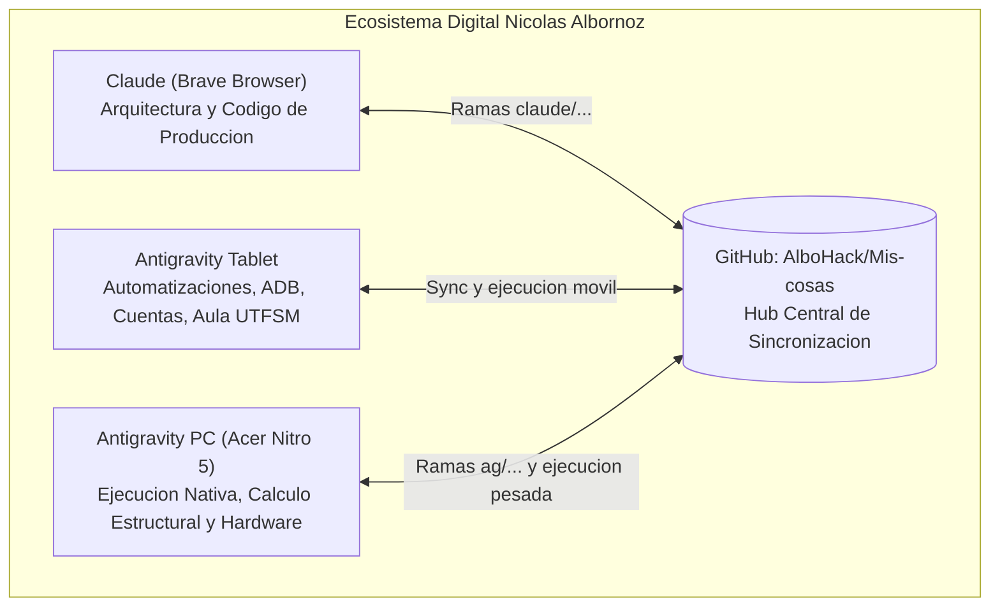

# Nodo: Antigravity PC (Acer Nitro 5)

## 1. Definición y Rol en el Ecosistema Tripartito
Este nodo representa la estación de trabajo de escritorio y cálculo pesado de Nicolás Albornoz. Dentro del ecosistema distribuido:

- **Claude (vía Brave Browser):** Diseñador principal de software y redactor de código de producción. Trabaja en ramas `claude/<tema>`.
- **Antigravity (Tablet):** Maneja integraciones de servicios, APIs móviles, credenciales de cuentas, tareas de Aula y rclone.
- **Antigravity (PC - Este nodo):** Ejecutor nativo en Windows 11. Resuelve matrices de rigidez pesadas, FEA en SAP2000 v27, scripts de MATLAB R2025a, compilación LaTeX, telemetría de hardware y optimización de recursos.

---

## 2. Ficha Técnica de Hardware (Acer Nitro 5 AN515-43)

| Componente | Especificación Técnica | Configuración de Operación |
|---|---|---|
| **CPU** | AMD Ryzen 7 3750H (4 núcleos / 8 hilos, Zen+, 2.3 GHz base, 4.0 GHz boost) | C-States equilibrados, perfil de energía Acer Nitro |
| **GPU Integrada** | AMD Radeon RX Vega 10 Graphics | **UMA Frame Buffer reducido de 2048 MB a 512 MB** mediante Smokeless_UMAF EFI. Liberó 1.5 GB de RAM física directa al sistema operativo |
| **GPU Dedicada** | NVIDIA GeForce GTX 1650 (4 GB GDDR5, Turing TU117) | Forzada para SAP2000 v27, MATLAB R2025a, Java (Minecraft) y Destiny 2 vía `HKCU:\Software\Microsoft\DirectX\UserGpuPreferences` (`GpuPreference=2;`) |
| **Memoria RAM** | 12 GB DDR4 a 2400 MHz (4 GB soldados + 8 GB SODIMM) | **Flex Mode (Asymmetric Dual Channel):** Primeros 8 GB corren a 128-bit (Dual Channel); los 4 GB restantes corren a 64-bit (Single Channel). El tope recomendado de asignación por proceso crítico es 6 GB |
| **Almacenamiento C:** | Kingston SA400M8120G (120 GB SATA M.2 SSD) | Aloja Windows 11 x64, `pagefile.sys` gestionado por el sistema y SAP2000 v27. Mantenimiento: **exclusivamente TRIM** (`defrag.exe C: /L /U`), jamás desfragmentación |
| **Almacenamiento D:** | WDC WD10SPZX-21Z10T0 (1 TB SATA HDD 5400 RPM) | Aloja juegos, MATLAB R2025a, descargas y el repositorio `D:\Mis-cosas`. Mantenimiento: desfragmentación periódica offline |

---

## 3. Entorno de Software y Rutas Clave

- **Repositorio local:** `D:\Mis-cosas`
- **Herramientas de optimización:** `antigravity-pc/optimizacion/` (espejo en `%USERPROFILE%\OneDrive\Escritorio\`)
- **Paquete de cálculo UTFSM:** `utfsm-calc` (`pip install -e utfsm-calc`)
- **Software de Ingeniería:**
  - SAP2000 v27: `C:\Program Files\Computers and Structures\SAP2000 27\SAP2000.exe`
  - MATLAB R2025a: `D:\Matlab\bin\matlab.exe`
  - LINGO 22: `D:\LINGO64_22\LINGO64_22.exe`
- **Configuración de juegos:**
  - Destiny 2: `%APPDATA%\Bungie\DestinyPC\prefs\cvars.xml` con `force_enable_multi_threaded_render_submit = 1` y `hdr_output = 0`.
  - Minecraft: JVM flags G1GC con memoria máxima fijada en 6 GB (`-Xms5120M -Xmx6144M`).

---

## 4. Convenciones de Trabajo y Rigor (Nicolás Albornoz - UTFSM)
1. **Punto decimal estricto:** Punto decimal en todo código, informe y LaTeX (`es-nodecimaldot`).
2. **Unidades:** Tonf, m y °C en ingeniería estructural; UF y CLP en gestión y construcción (FICA).
3. **Convención de signos:** Esfuerzo axial $N > 0$ tracción; en diagramas de flexión, $M > 0$ tracciona la fibra inferior en vigas y la fibra interior en columnas; giros y momentos antihorarios positivos.
4. **Verificación independiente:** Ningún cálculo estructural se da por bueno sin un segundo método independiente o comprobación estricta de equilibrio global.
