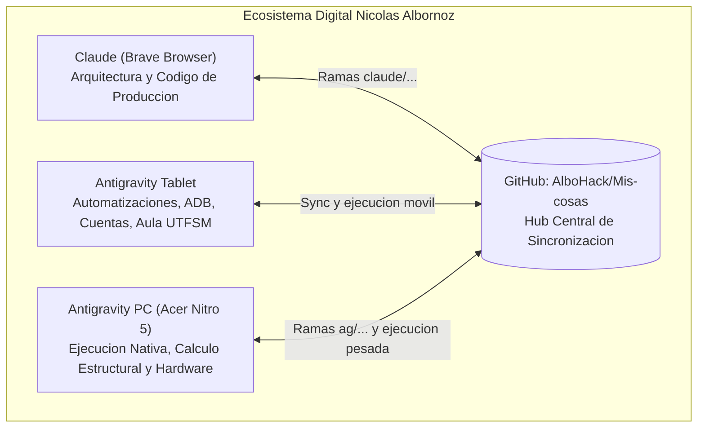

# Nodo: Antigravity Tablet (Xiaomi Pad 5)

## 1. Definición y Rol en el Ecosistema Tripartito
Este nodo representa la estación móvil de automatizaciones, sincronización continua y procesamiento de datos de Nicolás Albornoz. Dentro del ecosistema distribuido:

- **Claude (vía Brave Browser):** Diseñador principal de software y redactor de código de producción. Trabaja en ramas `claude/<tema>`.
- **Antigravity (Tablet - Este nodo):** Motor de automatización en segundo plano: sincronización de Aula USM (Moodle Web Services), gestión de eventos en el calendario nativo de Android vía ContentProvider / ADB, respaldos sincronizados en Google Drive mediante `rclone`, y recolección programada de mercado.
- **Antigravity (PC):** Ejecutor nativo en Windows 11 para cálculo estructural pesado (SAP2000 v27, MATLAB R2025a, LINGO) y telemetría de hardware.

---

## 2. Ficha Técnica de Hardware y Sistema Operativo

| Componente | Especificación Técnica | Configuración de Operación |
|---|---|---|
| **Dispositivo** | Xiaomi Pad 5 (código de modelo `21051182G`, nombre clave `nabu`) | Operación 24/7 conectada a red local |
| **SoC / CPU** | Qualcomm Snapdragon 860 (Kryo 485, 8 núcleos: 1x 2.96 GHz, 3x 2.42 GHz, 4x 1.78 GHz, 64-bit) | Arquitectura `aarch64` |
| **GPU** | Qualcomm Adreno 640 | Integrada |
| **Memoria RAM** | 6 GB LPDDR4X | Gestión de memoria optimizada por HyperOS |
| **Almacenamiento Interno** | 128 GB UFS 3.1 | Partición de datos montada con cifrado nativo |
| **Sistema Operativo** | Android 13 / Xiaomi HyperOS 1.0 | Kernel Linux `4.14.180-perf-g98d7380da` (SMP PREEMPT) |

---

## 3. Entorno de Software, Rutas Clave y Herramientas

### Entorno y Rutas
- **Entorno CLI:** Entorno Termux / Antigravity CLI (`PREFIX=/data/data/com.agycli/files/usr`).
- **Shell:** `bash` (versión 5.2.37).
- **Ruta del Repositorio Principal:** `/data/data/com.agycli/files/home/Mis-cosas`
- **Ruta de Worktree Mercado:** `/data/data/com.agycli/files/home/Mis-cosas-mercado` (rama `datos/mercado`)
- **Directorio de Descargas / Datos en Almacenamiento Compartido:** `/storage/emulated/0/Download/Universidad/`
- **Destino Remoto en Google Drive:** `gdrive:Universidad/2026-2/`

### Herramientas Instaladas y Versiones
- **Git:** `git version 2.56.0`
- **Python:** `Python 3.14.8` (estándar, sin dependencias pip externas innecesarias)
- **Rclone:** `rclone v1.75.2-termux` (configurado con backend OAuth Google Drive)
- **ADB:** `Android Debug Bridge version 1.0.41 (Version 35.0.2-12147458)` conectado a `127.0.0.1:5555`

---

## 4. Tareas Programadas Activas (Cron / Demonios)

- **Demonio de Cron:** `crond` activo en segundo plano (PID en ejecución continua).
- **Tablas de Cron (`crontab -l`):**
  1. `7 * * * * python3 /data/data/com.agycli/files/home/Mis-cosas/scripts/programador_sync.py >/dev/null 2>&1 # sync-aula-usm`
     - Se ejecuta cada hora al minuto 7.
     - Evalúa de forma determinística si corresponde sincronizar Aula USM según la ventana horaria de los sábados o si hubo intentos fallidos previos con backoff exponencial.
     - Registro de estado: `~/.sync_programador.json` (`ultimo_intento` y `ultimo_ok`).
  2. `13 9 */3 * * sh /data/data/com.agycli/files/home/Mis-cosas/mercado/actualizar_datos.sh >/dev/null 2>&1 # mercado-etf`
     - Se ejecuta cada 3 días a las 09:13 h para actualización de precios y datos públicos de ETF.

---

## 5. Scripts en Ejecución y Estado Operativo (Última Semana)

| Script / Flujo | Función Principal | Estado y Frecuencia |
|---|---|---|
| `scripts/sincronizar_sabados.sh` | Orquestador maestro de sincronización de Aula USM, verificación de token, red y rclone. | Activo. 100% OK en todas las corridas recientes. |
| `scripts/sincronizar_aula_semanal.py` | Descarga diferencial Moodle API, extracción de enunciados (`introattachments`), subida a Drive y actualización de repositorio. | Activo. Incorpora reclasificación Unicode y generación de contextos. |
| `scripts/sincronizar_calendario_android.py` | Sincronización bidireccional idempotente de evaluaciones con Google Calendar nativo de Android vía ContentProvider. | Activo. 15 hitos verificados sin errores. |
| `scripts/generar_contexto_ramos.py` | Generador incremental de `Contexto_Asignatura.md` para cada curso y `Contexto_Semestre_2026-2.md`. | Activo. Integrado en el paso 6.5 del sincronizador. |
| `mercado/descargar.sh` / `actualizar_datos.sh` | Descarga de cotizaciones históricas de ETFs en worktree `Mis-cosas-mercado`. | Activo según cron. |

### Historial de Fallas en la Última Semana
- **2026-10-26 19:20:** Fallo transitorio por token expirado (`CON ERRORES (1)`). Renovado y validado en la misma sesión (`2026-10-26 19:31: OK`).
- **2026-10-27 a 2026-11-03:** Cero fallas en producción. Todas las sincronizaciones terminadas con estado `OK`.

---

## 6. Seguridad Defensiva y Protección de Datos
1. **Regla de Credenciales:** Prohibido subir o exponer en repositorios cookies de sesión, tokens de Aula o credenciales personales (`chmod 600` estricto en `~/.moodle_token`).
2. **Hook de Pre-push:** Verificación activa mediante `.git/hooks/pre-push` para impedir subida accidental de código no autorizado a `main`.
3. **Auditoría Local:** Registro de trazabilidad en `/storage/emulated/0/Download/Universidad/Registro_Sincronizaciones.log`.
