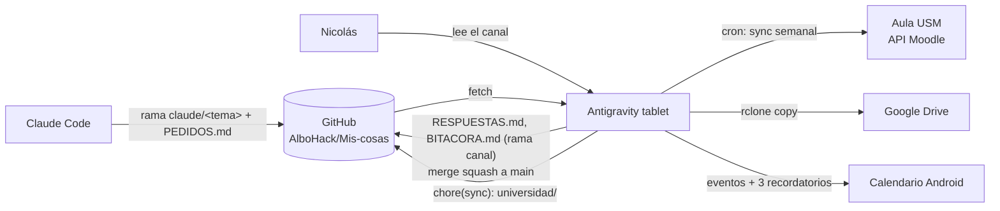

# Antigravity tablet

Nodo de ejecución en la Xiaomi Pad 5 (Android 13 / HyperOS) de Nicolás. Corre Antigravity CLI (`agy`, Gemini Flash) dentro de un entorno tipo Termux (`com.agycli`) y tiene lo que ningún otro nodo tiene: el token de Aula, `rclone` con Google Drive, el calendario Android y `adb`.

## Actores
| Actor | Hace | No hace |
|---|---|---|
| Claude Code (claude.ai/code) | Jefe técnico: escribe todo el código en ramas `claude/<tema>`, lo prueba con datos simulados, escribe los pedidos | No ve la tablet |
| Antigravity tablet (AG) | Ejecuta pruebas y scripts reales, hace el merge squash a `main` si todo pasa, reporta | No escribe código de producción ni consulta otros modelos |
| Nicolás | Autoriza borrados, cambios de cuentas, pagos y mensajes a su nombre; dice a AG "lee el canal" | — |

Hasta el 2026-11-03 el supervisor era una sesión de claude.ai y Nicolás copiaba a mano los mensajes `[AG]` y `[Claude → AG]`. Desde esa fecha supervisa Claude Code y la conversación va por la rama `canal` (ver [protocolo.md](protocolo.md)).

## Flujo

## Documentos
| Archivo | Contenido |
|---|---|
| [protocolo.md](protocolo.md) | Resumen de la regla 04 y del canal |
| [plantilla-prompt.md](plantilla-prompt.md) | Forma de un pedido y del reporte de AG |
| [sync-aula.md](sync-aula.md) | Arquitectura de la sincronización con Aula, programación y pruebas |
| [errores-y-lecciones.md](errores-y-lecciones.md) | Fallas pasadas que no deben repetirse y lecciones al trabajar con AG |
| [estado.md](estado.md) | Ramas pendientes y reportes esperados, con fecha |
| [CONTEXTO.md](CONTEXTO.md) | Equipo, versiones, rutas y tareas programadas, escrito por la tablet (P1) |
