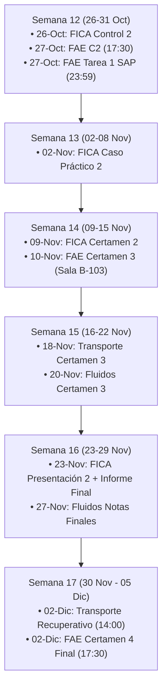

# 🎓 CONTEXTO ACADÉMICO INTEGRAL - SEMESTRE 2026-2
**Universidad Técnica Federico Santa María (UTFSM / USM)**  
**Departamento de Obras Civiles — Ingeniería Civil**  
*Documento maestro de contexto y sincronización para asistentes de inteligencia artificial (Claude, ChatGPT, etc.)*

---

## 👤 1. Perfil del Estudiante y Entorno
* **Nombre:** Nicolás Eduardo Albornoz Pavez
* **Correo Institucional:** `nicolas.albornozp@usm.cl`
* **Correo Personal / Google:** `albornoz.pavez@gmail.com`
* **Carrera:** Ingeniería Civil (Mención Estructuras / Construcción / Hidráulica / Transporte)
* **Semestre:** Segundo Semestre 2026 (2026-2)
* **Fecha de corte de este reporte:** 25 de Octubre de 2026 (Semana 12 del semestre académico)
* **Zona Horaria:** Santiago de Chile (America/Santiago / UTC-3)

---

## 📚 2. Panorama General de Asignaturas

### 🏗️ 1. FICA — Fundamentos de Ingeniería de Construcción y Administración
* **Sigla Oficial:** `CIV222` | **Aula ID:** `62177` | **Créditos SCT:** 140 horas cronológicas
* **Horario de Cátedra:** Lunes | Bloques 11-12 (16:00 - 17:10) y Bloques 13-14 (17:30 - 18:40)
* **Temario Principal:** Ciclo de vida de proyectos de construcción, prefactibilidad económica, presupuestos, cubicaciones, análisis de precios unitarios (APU), cartas Gantt, método del camino crítico (CPM), estándares PMBOK (6ta y 7ma edición), licitaciones públicas y herramientas de gestión moderna.
* **Evaluaciones Pasadas:**
  * Entrega Proyecto / Diagnóstico (Aprobado en agosto).
  * Tarea 1: Caso Edificio Kandinsky (Aprobado el 30 de agosto).
  * Control 1: Estados de Pago y curvas de avance (Aprobado el 6 de septiembre).
  * Presentación 1 + Informe de Avance (Completado).
* **Próximas Obligaciones y Fechas:**
  1. **Control 2:** Lunes 26 de Octubre de 2026 — 16:00 h *(¡MAÑANA!)*
  2. **Caso Práctico 2:** Lunes 02 de Noviembre de 2026 — 16:00 h
  3. **CERTAMEN 2:** Lunes 09 de Noviembre de 2026 — 16:00 h
  4. **Presentación 2 + Informe Final de Proyecto:** Lunes 23 de Noviembre de 2026 — 16:00 h

---

### 🏛️ 2. FAE — Fundamentos de Análisis Estructural
* **Sigla Oficial:** `CIV233` | **Aula ID:** `62178` | **Créditos SCT:** 187 horas cronológicas
* **Horarios y Salas:**
  * **Cátedra:** Miércoles | Bloques 13-14 (17:30 - 18:40) y 15-16 (18:50 - 20:00) | **Sala A012**
  * **Ayudantía:** Viernes | Bloques 7-8 (12:30 - 13:40) | **Sala K300**
* **Equipo Docente y Ayudantes:**
  * Ayudante 1: Gabriel Flores (`gabriel.floresf@usm.cl`)
  * Ayudante 2: Matías Muñoz (`mmunozr@usm.cl`)
* **Herramientas de Software:** SAP2000 v27 (Licencias educacionales CSI).
* **Temario Principal:** Trabajo virtual, teoremas de energía (Castigliano, Betti-Rayleigh), método de las fuerzas / flexibilidades en estructuras hiperestáticas (vigas, pórticos, reticulados), deformaciones por temperatura, defectos de fabricación y asentamientos diferenciales de apoyos.
* **Evaluaciones Pasadas:**
  * Certamen 1: 29 de Septiembre (Unidades 1 y 2: Conceptos básicos y trabajo virtual) — Notas publicadas.
* **🚨 ALERTA CRÍTICA Y PRÓXIMAS FECHAS:**
  1. **CERTAMEN 2 (Reprogramado):** Martes 27 de Octubre de 2026 (17:30 a 20:00 h | Salas B-103 / A012)  
     *(Postergado formalmente desde el 20-Oct por la cátedra debido a alerta meteorológica e inundaciones en Santiago).*
  2. **Cierre Entrega Tarea N°1 (SAP2000):** Martes 27 de Octubre de 2026 — hasta las 23:59 h en Aula USM  
     *(Plazo extendido por el equipo docente para coincidir con el C2).*
  3. **CERTAMEN 3:** Martes 10 de Noviembre de 2026 (17:30 a 20:00 h | Sala B-103)
  4. **CERTAMEN 4 (Examen Final):** Miércoles 02 de Diciembre de 2026 (17:30 a 20:00 h | Sala A012)

---

### 🌊 3. Fluidos — Mecánica de Fluidos
* **Sigla Oficial:** `CIV244` | **Aula ID:** `62182` | **Créditos SCT:** 203 horas cronológicas
* **Profesor:** Francisco Soto Simpson (Aula muestra a Ricardo Quinteros, KS-203, en la ficha del ramo)
* **Temario Principal:** Estática de fluidos, fuerzas sobre compuertas planas y curvas, cinemática de fluidos, leyes de conservación integrales (volumen de control, Reynolds), ecuación diferencial de Navier-Stokes, ecuación de Euler y Bernoulli aplicada a conductos y tuberías.
* **Evaluaciones Pasadas:**
  * Laboratorio 1: Fuerzas sobre superficies planas (Hidrostática) — Realizado en septiembre.
  * Certamen 1: Unidades 1 y 2 — Rendido y calificado.
  * Laboratorio 2: Aplicación de Bernoulli — Recuperado el 21 de octubre.
  * Certamen 2: Unidades 3 y 4 (Euler y Bernoulli) — Rendido a mediados de octubre.
* **Próximas Obligaciones y Fechas:**
  1. **CERTAMEN 3:** Viernes 20 de Noviembre de 2026 (14:00 - 16:30 h)  
     *Contenidos:* Unidades 5 y 6 (Ecuaciones de Navier-Stokes y conservación avanzada).
  2. **Entrega de Notas Finales:** Viernes 27 de Noviembre de 2026 (12:00 h en Aula / SIGA).

---

### 🚦 4. Transporte — Ingeniería de Transporte
* **Sigla Oficial:** `CIV386` | **Aula ID:** `62192` | **Créditos SCT:** 145 horas cronológicas
* **Profesor:** Cristóbal Pineda A. | Salas habituales: **B014 / B103**
* **Temario Principal:** Planificación de transporte urbano, análisis y pronóstico de demanda, modelos de cuatro etapas (generación, distribución, partición modal con Logit multinomial, asignación en redes de Wardrop) y modelación de Ortúzar.
* **Evaluaciones Pasadas:**
  * Certamen 1: Conceptos básicos de movilidad — Rendido.
  * Certamen 2: Modelos de Distribución y Partición Modal — Notas publicadas el 17/10, recorrección el 20/10.
* **Próximas Obligaciones y Fechas:**
  1. **CERTAMEN 3:** Miércoles 18 de Noviembre de 2026 (14:00 - 16:30 h | Salas B014 / B103)  
     *Material de estudio:* Guía N°3 y capítulos del libro de Juan de Dios Ortúzar (2011).
  2. **Certamen Recuperativo:** Miércoles 02 de Diciembre de 2026 (14:00 - 16:30 h | Salas B014 / B103).

---

### 👷‍♂️ 5. Prácticas — Prácticas Obras Civiles
* **Sigla Oficial:** `POC_SJ_VV` | **Aula ID:** `5623`
* **Encargada del Proceso:** Camila Almonacid (`practicas.oocc@usm.cl`)
* **Mecánica:** Prácticas industriales y operarias en empresas del sector construcción/minería. Las entregas de informes y convalidaciones no tienen certamen fijo, sino revisión por orden de llegada con validación académica en SIGA.

---

## 🗓️ 3. Cronograma Crítico Semana a Semana (Octubre - Diciembre 2026)

### Detalle Cronológico:
* **Lunes 26 de Octubre (16:00 h):** FICA — Control 2.
* **Martes 27 de Octubre (17:30 a 20:00 h):** FAE — CERTAMEN 2 (Reprogramado).
* **Martes 27 de Octubre (hasta 23:59 h):** FAE — Entrega Tarea N°1 SAP2000.
* **Lunes 02 de Noviembre (16:00 h):** FICA — Caso Práctico 2.
* **Lunes 09 de Noviembre (16:00 h):** FICA — CERTAMEN 2.
* **Martes 10 de Noviembre (17:30 a 20:00 h):** FAE — CERTAMEN 3 (Sala B-103).
* **Miércoles 18 de Noviembre (14:00 a 16:30 h):** Transporte — CERTAMEN 3.
* **Viernes 20 de Noviembre (14:00 a 16:30 h):** Fluidos — CERTAMEN 3.
* **Lunes 23 de Noviembre (16:00 h):** FICA — Presentación 2 + Informe Final.
* **Viernes 27 de Noviembre (12:00 h):** Fluidos — Publicación de Notas Finales.
* **Miércoles 02 de Diciembre (14:00 a 16:30 h):** Transporte — Certamen Recuperativo.
* **Miércoles 02 de Diciembre (17:30 a 20:00 h):** FAE — CERTAMEN 4 (Examen Final, Sala A012).

---

## 💻 4. Ecosistema de Automatización Local (Tablet Xiaomi Pad 5)
1. **Calendario Nativo de Google / Android:**
   * Las 12 evaluaciones están inyectadas directamente en el proveedor nativo de calendario (`calendar_id=7` para `albornoz.pavez@gmail.com`).
   * Cada evaluación cuenta con **3 alarmas automáticas**:
     * 1 semana antes (`10080` min).
     * 3 días antes (`4320` min).
     * 1 día antes (`1440` min).
   * **Ventaja:** No requiere Microsoft Authenticator, códigos de verificación ni PIN `6969`. Suenan directamente en la tablet y sincronizan con cualquier dispositivo conectado a tu cuenta de Google.
2. **Sincronización Semanal Autónoma:**
   * Script principal: [`/data/data/com.agycli/files/home/sincronizar_aula_semanal.py`](file:///data/data/com.agycli/files/home/sincronizar_aula_semanal.py)
   * Programación en cron: **Todos los sábados a las 10:00 AM** (`0 10 * * 6`).
   * Descarga diferencial de documentos, análisis de anuncios en foros, actualización del calendario local y subida del paquete maestro [`Universidad_2026-2_Completo.zip`](file:///storage/emulated/0/Download/Universidad_2026-2_Completo.zip) a tu Google Drive.

---

## 🤖 5. Prompt de Inicio para Cualquier Asistente de IA

> *"Hola, soy Nicolás Albornoz Pavez, estudiante de Ingeniería Civil en la USM (Chile), cursando el semestre 2026-2. Te entrego este documento de contexto con mis 5 asignaturas (FICA, FAE, Fluidos, Transporte y Prácticas), sus profesores, ponderaciones, contenidos y el cronograma semana a semana de mis certámenes y entregas. Por favor, asume el rol de mi tutor y asistente académico: ayúdame a planificar mis sesiones de estudio, resolver ejercicios de las materias y recordarme siempre las fechas límites y prioridades semanales basándote en este contexto."*
